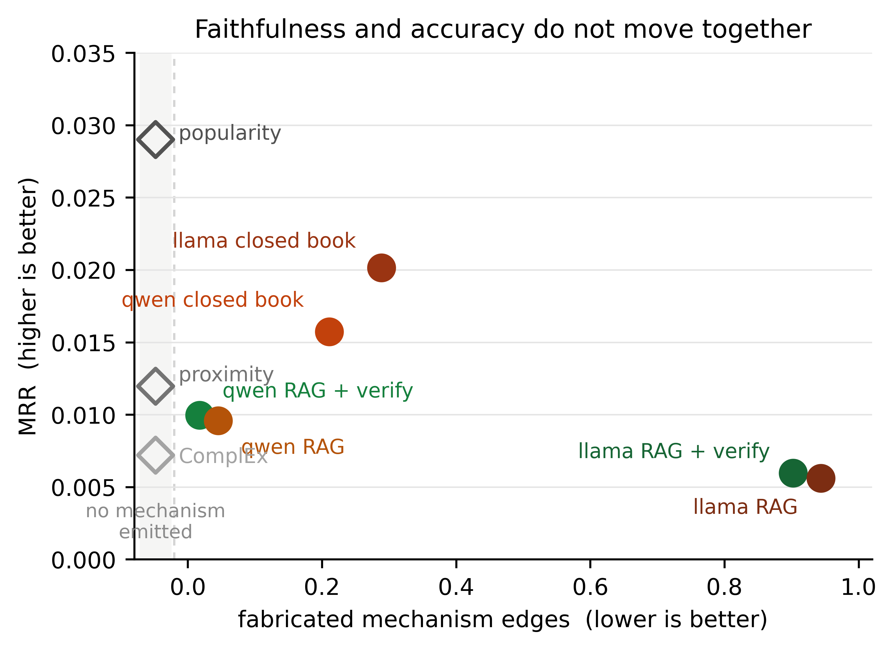
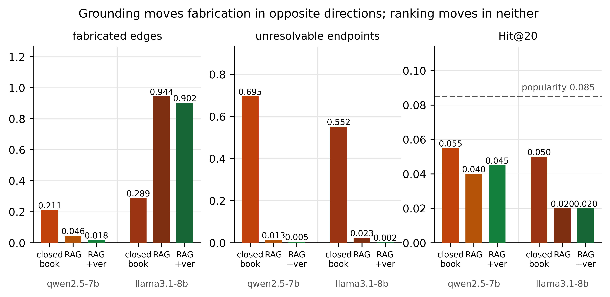
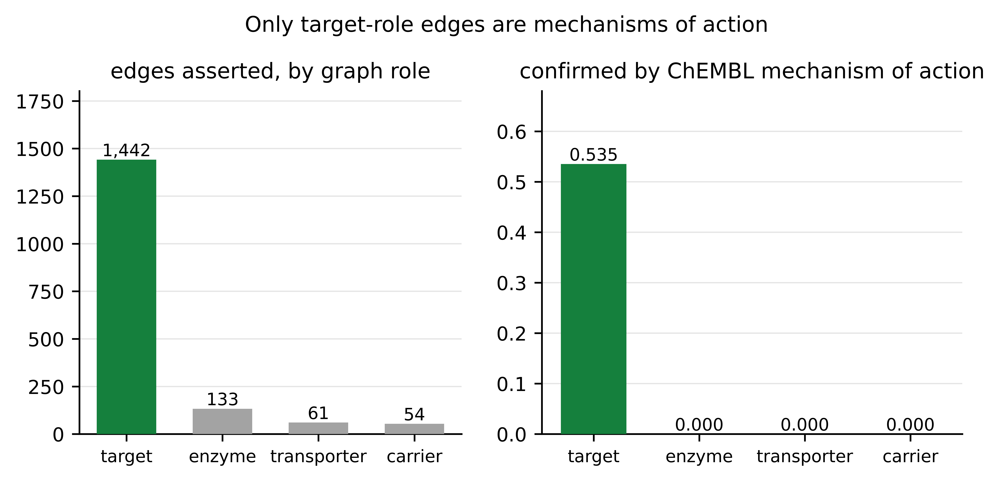

# Can an LLM agent justify what it recommends? A mechanism-verified, time-split benchmark for drug repurposing

**Authors.** Nhat Trinh Ngoc Minh^a^ (ORCID 0009-0006-9477-9642),
Linh Nguyen Thi My^a^ (ORCID 0000-0003-3990-312X)

^a^ Faculty of Information Technology, Van Lang School of Technology, Van Lang University,
69/68 Dang Thuy Tram Street, Binh Loi Trung Ward, Ho Chi Minh City, Vietnam

**Corresponding author:** Linh Nguyen Thi My, linh.ntm@vlu.edu.vn
**Author e-mails:** nhat.2474802010280@vanlanguni.vn; linh.ntm@vlu.edu.vn

---

## Abstract

**Background.** Large language model (LLM) agents are being applied to drug repurposing, but
evaluations rarely establish two things a reader needs: that the agent could not have seen the
answer, and that the mechanism it offers is real.

**Results.** Every source an agent may query is frozen at 2021-12-31, and agents are scored on
pairs whose first phase 2 or later trial, or new-indication approval, falls after it: 2,731 pairs
unknown at the cutoff by three independent criteria, 546 on a frozen 194-disease evaluation set.
Each proposal carries a mechanism path, every edge checked against graph relations or a
cited pre-cutoff abstract. *Fabricated* edges are reported apart from *unresolvable* ones; merging them
overstates fabrication threefold. Across 14,065 proposals from two open-weight models, grounding
acts strongly on faithfulness and not on accuracy: `qwen2.5-7b`'s fabrication falls from 0.208
closed book to 0.039 with graph tools and 0.018 with verification, while `llama3.1-8b`'s rises
from 0.290 to 0.942. Verification leaves ranking unchanged in both (ΔMRR 0.0004, *p* = 0.72 and
0.64), and no configuration of either model matches a popularity baseline (MRR 0.030 against
0.006–0.021). A leakage probe with controls finds no post-cutoff signal above its floor.

**Conclusions.** Faithfulness and usefulness are decoupled: the least verifiable configuration
ranks best, and where ChEMBL records a development phase, 41.1% of verified proposals name a
compound that never reached approval. Verification buys checkability, not discovery, and
grounding's effect on fabrication is a property of the model, so single-model evidence is unsafe.

**Availability.** Code, splits, cached evidence and reports: https://github.com/MinhNhat-2504/repurpose-verify

**Keywords.** drug repurposing; large language model agents; benchmark; data leakage;
knowledge graphs; hallucination; evaluation

---

## 1 Introduction

Computational drug repurposing is an attractive target for LLM agents. The task rewards wide
reading, the evidence is public, and the output — a short ranked list with an argument for each
entry — is the kind of thing language models produce fluently. Recent reviews of agentic AI in
drug discovery identify evaluation as the field's weak point rather than capability [1].

Two specific weaknesses motivate this work.

Retrospective evaluation does not establish prospective skill. A system is usually scored on
held-out associations drawn from the same curated sources it reads. Those associations are
historical facts: the indication is in DrugBank, the gene–disease link is in DisGeNET, the trial
is in the literature. High accuracy under such a split is consistent with retrieval rather than
inference. Audits of adjacent benchmarks have found exactly this kind of contamination across
widely used splits, and have shown that which model leads a leaderboard can change once the test
set's composition is corrected [2]; evaluated inductively rather than transductively, drug–target
models generalise considerably worse than their reported figures suggest [3].

A fluent mechanism is not a verified one. When an agent explains that drug D hits target T
which drives disease S, the explanation is usually either taken at face value or scored by
another language model. Neither establishes that the edges exist. The failure is not
hypothetical: across the 194 evaluation diseases an agent with a literature-search tool available called it
once, and every one of the twenty PubMed identifiers it volunteered was invented
(Section 7.3).

We address both by construction.

1. A time split with the evidence base frozen. The agent sees a 2021 knowledge graph and
   PubMed filtered by publication date; it is scored on what entered the clinic afterwards
   (Section 3).
2. A mechanism verifier. Every proposal must present a path from drug to disease through at
   least one gene, and every edge is checked against graph relations or a cited pre-cutoff
   abstract (Section 4).

Our contributions are:

* A leakage-audited, time-split ground truth of 2,731 novel drug–disease pairs, with the audit
  reported rather than asserted (Section 7.1).
* A mechanism verifier whose evidence taxonomy distinguishes a false claim from an uncheckable
  one, and the demonstration that conflating them inflates measured fabrication threefold
  (Sections 4, 7.3).
* A measurement of what verification buys and what it does not: fabricated edges fall 2.2-fold
  when rejected proposals are returned for one revision round, while ranking does not move
  (*p* = 0.72) and no configuration reaches a popularity baseline (Section 7.3).
* A *verifiable ceiling*: only 61.4% of our positives admit any mechanism path, a bound on
  mechanism-verified evaluation that is a property of the knowledge base, not of the model
  (Section 7.1).
* A weight-level leakage probe with positive and negative controls, so that "no leakage found"
  is distinguishable from "the probe cannot detect leakage" (Section 7.4).
* An open implementation in which every external response is cached, so a reported run can be
  re-scored, or re-run offline, by a reviewer (Section 8).

## 2 Related work

Knowledge-graph repurposing. Hetionet established the template of ranking drugs for a
disease by paths in a heterogeneous biomedical graph [4]. PrimeKG consolidates twenty primary
resources into a single graph aimed at precision medicine [5], and TxGNN trains a graph neural
network on it for zero-shot indication prediction, with a clinician-facing interface [6].
Network proximity methods score a drug by the graph distance between its targets and the
disease's genes [7]. General-purpose link predictors — TransE [8], DistMult [9], ComplEx [10] —
remain standard baselines. These systems rank; they do not produce or defend a mechanism, and
they are typically evaluated on associations already present in the graph.

LLM agents in biomedical discovery. Agentic systems now perform literature synthesis,
property prediction and candidate generation. Reviews of the area single out reliability and the
absence of agreed benchmarks as the limiting factors rather than raw capability [1].
Where mechanisms are reported, they are rarely machine-checked.

Leakage and benchmark auditing. Transductive drug–target interaction models have been shown to report inflated performance
under the evaluation setups used in the literature, and to generalise poorly to the inductive
setting that repurposing actually requires [3]. An audit of over fifty benchmark dataset
configurations found pervasive cross-split contamination, label conflicts and structural
redundancy, with drug–target interaction datasets singled out for extensive protein overlap
between splits [2]. Our ground truth is built to be auditable in the same
spirit, and we report the audit alongside the data.

Position of this work. We do not propose a new predictor. We propose an evaluation under
which a predictor's *justification* is checkable, and we measure existing systems under it.

## 3 Benchmark construction

### 3.1 Knowledge snapshot

We use PrimeKG [5] as the pre-cutoff knowledge base: 129,375 nodes and 4,050,249 undirected
edges, including 7,957 drugs, 27,671 genes or proteins, 17,080 diseases and 2,516 pathways. Its
constituent resources were compiled around 2021, which matches our cutoff. We read PrimeKG's
`nodes.tab` and `edges.csv` distributions (395 MB) rather than the monolithic `kg.csv` (982 MB),
which repeats every node name on both sides of each edge, and verified that both yield an
identical graph (test `test_build_from_parts_matches_kg_csv`).

Disease grounding uses MONDO exact synonyms and MeSH cross-references [11]; gene grounding adds
HGNC alias symbols for 44,495 genes [12], joined on NCBI gene identifiers. Section 4.2 explains
why that join must be on identifiers and never on names.

### 3.2 Time-split ground truth

We query the ClinicalTrials.gov API v2 [13] for interventional studies with a drug or biological
intervention, partitioned by start date: 172,939 studies beginning on or before 2021-12-31 (any
phase) and 34,595 beginning afterwards with a maximum phase of 2, 3 or 4.

Interventions are mapped to graph drugs after stripping doses, salts and formulations and
splitting combination strings; generic arms (placebo, standard of care, saline) are discarded.
Conditions are mapped through the trial record's MeSH identifiers to MONDO cross-references,
falling back to name matching. A drug resolves in 64.2% of trials and a disease in 77.2%; the
unmatched remainder is dominated by novel compounds absent from DrugBank and by conditions with
no MONDO equivalent.

Coverage says nothing about whether the mappings that *are* made are right, so we audited them.
Two hundred post-cutoff trials were sampled and each mapped entity judged against the trial
record: a row counts as correct when every entity the mapper produced corresponds to something
the trial actually studies. Precision is 0.990 (95% CI 0.970–1.000) over the 100 sampled
trials carrying a drug mapping and 0.889 (0.837–0.935) over the 153 carrying a disease
mapping. Trials where nothing mapped are not scored here: that is a recall miss, already
reported as coverage, and counting it again as a precision error would charge the same gap
twice.

This audit was run twice: once on the mapper as first written, and again after the grounding
corrections of Section 7.7, on the same 200 sampled trials under the same judgements. The
corrections raised drug precision from 0.942 to 0.990 by removing five of the six drug errors
the first pass had found, and left disease precision unchanged at 0.89. They cost four of the
104 drug mappings and one of the 154 disease mappings, which is the recall side of the same
change: the lost disease row is a trial whose condition read "Coronary Arterial Disease (CAD)",
which the graph matched only through the acronym because its own label is "coronary artery
disease".

The errors that remain fall into three kinds, all visible in the released sheet. Fuzzy name
matching occasionally latches onto a fragment of a chemical name — the IUPAC expansion of
navtemadlin contains a substring that matched `(S)-Warfarin`, an error the corrections removed.
Generic MeSH headings such as *Diagnosis* or
*Disease* resolve to the ontology's root, giving a meaningless `disease or disorder`. And a MeSH
heading auto-assigned to a trial is not always a condition under study: a trial of
chemotherapy-induced neuropathic pain carries the heading *Neoplasms*, which maps to a disease
the trial does not investigate. The judged sheet is released with the code.

A post-cutoff pair becomes a positive when a phase 2+ trial of that pair started in
(2021-12-31, 2026-12-31], or a curated regulatory approval of the new indication falls in the
same window, and the pair was unknown at the cutoff under all three of the following:

1. no `indication` or `off-label use` edge in the graph snapshot;
2. no trial of the pair, in any phase, starting on or before the cutoff;
3. not present in the curated approvals list before the cutoff.

Criterion 2 is what distinguishes this split from one built on curated indications alone: 66,126
pairs were already in trials before the cutoff without appearing as graph indications, and
counting them as novel would reward retrieval. Only trials testing exactly one graph drug
contribute, so that combination arms do not create spurious pairs.

### 3.3 Leakage controls

| Channel | Control | Audit |
|---|---|---|
| The graph contains the answer | Criterion 1 above; held-out pairs' drug–disease edges are additionally removed before any run | 0 of 2,731 positives have such an edge; 27 contraindication edges were removed |
| The pair was already in trials | Criterion 2, any phase | 66,126 pairs excluded |
| Literature after the cutoff | PubMed queried with `datetype=pdat&maxdate=2021/12/31`; every fetched record re-checked; later citations counted invalid | Invalid-citation rate reported per system |
| Model weights | Open-weight models with documented cutoffs; closed-book probe with controls; masked re-scoring | Section 7.4 |
| Verifier evidence | Open Targets (a live release containing post-cutoff evidence) disabled by default; reported separately when enabled | Off in all reported runs |

**Table 1.** Leakage channels, the control applied to each, and where it is audited.

### 3.4 Evaluation diseases and the verifiable ceiling

Of 1,143 diseases carrying at least one positive, 417 have no `disease_protein` edge at all. No
mechanism path can terminate at such a disease, so every proposal for it is unverifiable for a
reason that has nothing to do with the model. We therefore require at least one associated gene,
leaving 726 diseases, from which 200 were drawn (seed 13) and frozen as the evaluation split; 194
of them hold a positive under the corrected grounding, and those 194 hold 546 positives.

Within those 546 positives, only 335 (61.4%) are *mechanism-reachable*: the graph admits at
least one drug → gene (→ gene | → pathway → gene) → disease path of at most four edges. For 70
positives the drug has no recorded target at all. A system that reports only verified proposals
therefore cannot exceed 0.61 recall on this set. We release `mechanism_reachable` and `n_targets`
per pair so that the ceiling can be recomputed for any stratum, and we regard reporting it as
part of reporting the benchmark: without it, a verified-only system's recall is uninterpretable.

## 4 Mechanism verification

### 4.1 Proposal format and edge statuses

A proposal is a drug plus a path: a chain of (source, relation, target) edges beginning at the
drug, passing through at least one gene or protein, and ending at the queried disease (or a
graph-adjacent disease), of length 2 to 4 edges. Optional PubMed identifiers may be attached per
edge. Each edge receives one status (Table 2):

| Status | Meaning |
|---|---|
| `kg` | the grounded endpoints are joined in the snapshot by a biological relation |
| `literature` | a cited record published on or before the cutoff co-mentions both endpoints |
| `opentargets` | optional; a gene–disease association above threshold in a live release |
| `circular` | the only link between the endpoints is a drug–disease relation — the prediction target itself, hence not evidence |
| `unsupported` | both endpoints resolve, no admissible evidence links them |
| `ungrounded` | an endpoint resolves to no node of an acceptable type |
| `ambiguous` | an endpoint's name matches several nodes and nothing disambiguates them |

**Table 2.** Edge statuses assigned by the verifier.

A proposal is verified when the drug grounds, the path is a well-formed chain from drug to
disease through at least one gene, and every edge is supported. Excluding drug–disease relations
from the admissible evidence is essential: without it a model could "justify" an indication with
the indication edge.

### 4.2 Grounding, and why it decides the headline number

The verifier's grounding is the difference between a defensible fabrication rate and an
indefensible one. Three mechanisms matter.

Identifier joins, not name matching. An agent writing `COX-2` means PTGS2. A substring search
for `COX-2` in PrimeKG returns `COX2`, the mitochondrial cytochrome *c* oxidase subunit II — an
unrelated protein. We therefore attach HGNC aliases through NCBI gene identifiers (80,577 alias
symbols over 44,495 genes) and never resolve by string similarity to a primary name. Name
variants cover separator-free symbol forms (`COX-2`, `COX 2`, `COX2`; `IL-6`, `IL6`), and an
official node name outranks an alias so that a gene listing a symbol as an alias cannot outrank
the gene actually called that.

Explicit pins where curated sources conflict with usage. HGNC lists `COX-2` as an alias of
*PTGER2*, while drug-mechanism text uses it for PTGS2. Five such mentions are pinned in a
version-controlled file with the reason for each, rather than resolved silently
(`data/manual/gene_aliases.csv`).

Ambiguity is reported, not resolved. A mention matching several nodes yields `ambiguous`.
Choosing the best candidate instead would risk the worst outcome available to a verifier: an
invented edge marked as supported.

A fourth check concerns identifiers cited by the model. Agents may refer to nodes by graph
identifier (`kg:123`). If the accompanying name belongs to a different node, the endpoint is
treated as fabricated rather than resolved — a case observed in a live run, where a model
proposed invented drug names carrying real identifiers.

### 4.3 Separating fabrication from unverifiability

Our first implementation counted `unsupported`, `ungrounded`, `circular` and `ambiguous` together
as "fabricated", and reported 0.953 for a closed-book model. Inspecting the flagged endpoints
showed the figure was wrong in a way worth recording: most were real biology written informally
(`COX-2`, `VEGF`, `PDE5`, `AMPK`) or processes rather than entities (`inflammation`,
`oxidative stress`, `excitotoxicity`, `bone growth and development`). After identifier-based
alias expansion the same run scores 0.144 fabricated with 0.670 unresolvable.

We therefore report two quantities:

* Fabricated = `unsupported` + `circular`. Both endpoints are real entities and the evidence
  base records no link, or the only link is the label being predicted. These are checkable claims
  that the evidence contradicts.
* Unresolvable = `ungrounded` + `ambiguous`. The endpoint does not pick out one entity. The
  claim may be true; it is not checkable in this vocabulary.

Both are failures of a mechanism-verified system, and their sum (`unverified`) is reported too.
But they call for different remedies — better grounding versus better claims — and a single
merged number conceals which is which.

## 5 Systems evaluated

Knowledge-graph baselines, all restricted to the masked snapshot. *Popularity* ranks drugs by
their number of recorded indications. *Network proximity* scores a drug by overlap and
PPI-adjacency between its targets and the disease's genes, normalised by target count [7].
*TransE* [8], *DistMult* [9] and *ComplEx* [10] are trained on the snapshot with type-constrained
negative sampling and scored on the `indication` relation; we report ComplEx (dimension 128, five
epochs, 5 minutes on one RTX 4060). An importer accepts external rankings, e.g. TxGNN [6], as CSV
so that published systems can be placed on the same split.

LLM systems, all with the same prompt and tool budget (16 turns, top-20 output), are the
four configurations of Table 3:

| System | Retrieval | Verification |
|---|---|---|
| closed book | none | none |
| RAG, no verifier | graph tools + date-capped PubMed | none |
| RAG + verify-filter | same | unverified proposals demoted (or dropped) |
| RAG + verify-revise | same | rejected proposals returned once for repair, then filtered |

**Table 3.** The four agent configurations, which differ only in retrieval and verification.

Tools are: `search_entities`, `get_neighbors`, `find_mechanism_paths` (hub-penalised path
enumeration), `rank_candidate_drugs` (the proximity screen, with known indications removed) and
`search_pubmed` (date-capped). Ablations disable PubMed, the candidate screen or the graph tools
individually. Proposals from *every* system, including those whose ranking is not filtered, are
verified post hoc, so faithfulness is comparable across systems.

Two open-weight models of the same size class are reported, so that a difference between them
is a model difference and not a capacity one: `qwen2.5:7b` (documented cutoff 2023-10) and
`llama3.1:8b` (2023-12), both served locally. Two deployment
details affect reproducibility and are easy to get wrong: the server applies its own context
limit and truncates longer prompts silently, so runs use a derived model with the context raised
to 16,384 tokens; and concurrent requests against a single instance were observed to leave
established sockets with no response, so the default concurrency is one worker.

## 6 Metrics

### 6.1 Ranking

Rankings are *filtered*: drugs already used for the disease at the cutoff are removed before
scoring, as in disease-centric graph evaluation [6]. We report Hit@K and Recall@K for
K ∈ {1, 5, 10, 20} and MRR, with 95% confidence intervals from a disease-level bootstrap (1,000
resamples) and paired bootstrap comparisons against a reference system. A disease with no
ranking scores zero, so abstention is not rewarded; coverage is reported separately.

### 6.2 Faithfulness

Verified-proposal rate; fabricated- and unresolvable-edge rates with their components;
malformed-path rate; ungrounded-drug rate; and invalid-citation rate — the share of cited
identifiers that do not resolve or that postdate the cutoff.

### 6.3 Cost

Input and output tokens, monetary cost where a price is configured, and tokens or cost per
correct hit — the quantity that makes agentic and non-agentic systems comparable.

### 6.4 Validation that does not depend on expert raters

A blinded panel of pharmacists rating plausibility is the conventional check here, and it has two
problems for this paper. It is the method we argue against relying on — a human judgement that
another group cannot reproduce — and it does not address the objection a reviewer will actually
raise, which is that our verifier accepts an edge from the same graph the agent reads. We
therefore use three checks that are either automated or require no pharmacological judgement.

(a) Independent confirmation of drug–target claims. The first edge of every path is a claim
about a drug's protein target, accepted by the verifier because PrimeKG contains it. We re-check
those edges against ChEMBL's mechanism-of-action curation, a pipeline the agent never queried.
Drugs are mapped DrugBank [14] → ChEMBL [15] through UniChem [16] by chemical structure (InChI),
never by name,
for the reason given in Section 4.2. ChEMBL records no mechanism for many drugs; that is reported
as coverage, not counted as disagreement. The two resources are not fully independent — both
curate from labels and literature — so this is corroboration, not arbitration.

(b) Role sensitivity of "mechanism". PrimeKG merges four distinct relations into
`drug_protein`: target, enzyme, transporter and carrier. Only the first can be a mechanism of
action; a path through a drug's metabolising enzyme describes pharmacokinetics. We therefore
re-score every run under a stricter verifier that requires the drug→protein hop to be a curated
target, and report the change. This costs no model inference: the verifier re-reads stored
proposals.

(c) Post-cutoff literature corroboration. For each system's top-5 proposals we count PubMed
records published *after* the cutoff that co-mention the drug and the disease — an outcome signal
independent of ClinicalTrials.gov. Co-mention is weak evidence, and a system that names famous
drugs scores well on it, so each system is compared with a control of random drugs drawn for the
same diseases, as in the leakage probe.

We did not carry out an expert rating of any size, and we do not report one. Readers who want a
face-validity impression can take it from the worked examples in Sections 4.3 and 7.3 and from the
released proposals, each of which carries its full verification record.

## 7 Results

### 7.1 The benchmark

Table 4 summarises what the construction of Sections 3 and 4 produced.

| Quantity | Value |
|---|---|
| Graph | 129,375 nodes; 4,050,249 edges; 7,957 drugs; 17,080 diseases |
| Trials read | 172,939 pre-cutoff; 34,595 post-cutoff phase 2+ |
| Pairs known at the cutoff | 11,831 graph indications/off-label; 66,126 pre-cutoff trial pairs |
| Post-cutoff pairs found | 6,500 |
| Novel positives | **2,731** (phase 2: 1,570; phase 3: 601; phase 4: 536; approved: 24) |
| Diseases with a positive | 1,143 → 726 with ≥1 associated gene → **200 drawn**, of which 194 retain a positive (546 positives) |
| Leakage audit | **0** positives carry a drug–disease edge in the snapshot |
| Mechanism-reachable positives | **335 / 546 (61.4%)**; 70 positives' drugs have no recorded target |

**Table 4.** Benchmark composition at cutoff 2021-12-31.

Three features deserve emphasis. First, 58% of the post-cutoff pairs we found were discarded as
already known — the step that most distinguishes a time split from a random one. Second, the
61.4% reachability figure means that mechanism-verified evaluation on this knowledge base is
bounded well below perfect recall; a system reporting 0.5 recall under verification may be close
to the achievable maximum rather than far from it.

Third, the evaluation split is frozen rather than redrawn. Sampling the split from the pool of
eligible diseases makes its membership depend on the size of that pool: correcting the entity
grounding described in Section 7.7 changed the pool by 18 diseases out of 1,149 and that
reshuffled 129 of the 200 evaluation diseases, which would have invalidated every model run
behind this paper. The split is therefore stored as a file (`data/manual/eval_split.csv`) and
read back on every rebuild, and the fallback draw selects diseases by a hash of each disease's
own identifier so that a changed pool moves the split only at its margin. Six of the 200 drawn
diseases turn out to have no remaining positive once the grounding is corrected — in every case
their sole positive was a name-matching artefact, so no system could ever have scored on them —
and all reported metrics are over the remaining 194.

### 7.2 Knowledge-graph baselines

Over the 194 evaluation diseases and 546 positives, popularity reaches MRR 0.030 [0.015, 0.048],
network proximity 0.012 and ComplEx 0.007 (Table S1).

The absolute numbers are low: the task is to rank ~8,000 drugs for an average of 2.8 unseen
positives per disease, and the positives are, by construction, pairs that nothing in the 2021
evidence base had connected. We take this as a property of an honest time split rather than a
defect — a benchmark on which indication popularity already scored well would not be measuring
inference. Notably, popularity outperforms both structural methods, which is a useful warning
for any work reporting graph-based repurposing gains without a frequency baseline.

Under probe-masked scoring (Section 7.4) the same systems move by at most 0.005 Hit@20
(192 diseases, 522 positives), indicating the split is not sensitive to the handful of pairs the
probed model claims to know.

### 7.3 Faithfulness, accuracy, and the gap between them

Table 5 reports faithfulness for all six systems and Table 6 their ranking accuracy, over the
same diseases and the same positives.

| Model | System | Proposals | Verified | **Fabricated** | Unresolvable | Malformed path |
|---|---|---|---|---|---|---|
| qwen2.5-7b | closed book | 3,408 | 0.004 | **0.208** | 0.700 | 0.678 |
| qwen2.5-7b | RAG, no verifier | 2,506 | 0.908 | **0.039** | 0.014 | 0.039 |
| qwen2.5-7b | RAG + verify-revise | 2,410 | 0.959 | **0.018** | 0.005 | 0.017 |
| llama3.1-8b | closed book | 3,735 | 0.009 | **0.290** | 0.550 | 0.558 |
| llama3.1-8b | RAG, no verifier | 1,051 | 0.000 | **0.942** | 0.024 | 0.850 |
| llama3.1-8b | RAG + verify-revise | 955 | 0.030 | **0.899** | 0.002 | 0.845 |

**Table 5.** Faithfulness over the 194 evaluation diseases, 14,065 proposals from two models under
identical prompts, tools and budgets. Only `qwen2.5-7b`'s unverified configuration cited
anything: 20 PubMed identifiers, all invalid.

| Model | System | MRR | Hit@5 | Hit@20 | Coverage | Correct hits | Input tokens |
|---|---|---|---|---|---|---|---|
| — | **Popularity** | **0.030** | 0.057 | **0.088** | 1.000 | **17** | 0 |
| — | Network proximity | 0.012 | 0.021 | 0.057 | 1.000 | 11 | 0 |
| — | ComplEx | 0.007 | 0.000 | 0.041 | 1.000 | 8 | 0 |
| qwen2.5-7b | closed book | 0.016 | 0.041 | 0.057 | 0.995 | 13 | 83,398 |
| qwen2.5-7b | RAG, no verifier | 0.010 | 0.021 | 0.041 | 0.923 | 8 | 11,373,366 |
| qwen2.5-7b | RAG + verify-revise | 0.010 | 0.021 | 0.046 | 0.912 | 9 | 12,316,771 |
| llama3.1-8b | closed book | 0.021 | 0.036 | 0.052 | 0.964 | 11 | 80,716 |
| llama3.1-8b | RAG, no verifier | 0.006 | 0.010 | 0.021 | 0.608 | 4 | 1,844,408 |
| llama3.1-8b | RAG + verify-revise | 0.006 | 0.010 | 0.021 | 0.629 | 4 | 3,391,410 |

**Table 6.** Ranking over the same 194 diseases and 546 positives. "Correct hits" counts
positives recovered in a top-20 list, summed over diseases.



**Figure 1.** The two axes do not move together, in either model. Filled circles are the LLM
systems — green where proposals are verified, orange where they are not, darker shades for
`llama3.1-8b` — and open diamonds are the knowledge-graph baselines, which emit no mechanism and
therefore have no fabrication rate; they are placed in the shaded strip rather than at zero,
which would read as "never fabricates" instead of "makes no checkable claim". Within each model
the least faithful configuration ranks best, the two models' grounded configurations sit at
opposite ends of the fabrication axis, and the baseline that reads nothing ranks best of all.



**Figure 2.** The same intervention on two models. Grounding drives `qwen2.5-7b`'s fabricated
edges down (0.208 → 0.039 → 0.018) and `llama3.1-8b`'s up (0.290 → 0.942 → 0.899), while for
both it empties the unresolvable column — the errors move from uncheckable to checkable, and
which way they then land is the model's doing. Hit@20 is flat within each model, and all six
configurations sit below the popularity baseline (dashed).

On one model, grounding and verification act on faithfulness, strongly. With `qwen2.5-7b`,
the closed-book agent fabricates 20.8% of its mechanism edges, leaves 70.0% unresolvable,
produces malformed paths in 67.6% of proposals, and has 0.3% of its proposals verified — 12 of
3,516. Adding graph tools takes fabrication to 4.6% and unresolvable endpoints to 1.3%. Adding
edge-level verification with one revision round takes fabrication to 1.8%: three fifths of the
remaining fabricated claims disappear, for 9% more input tokens. The verified agent also submits
fewer proposals (2,410 against 2,506), part of the gain being claims withdrawn rather than
repaired, which is the intended behaviour.

On the other model, the same intervention makes fabrication worse. With `llama3.1-8b`,
grounding takes the fabricated-edge rate *up*, from 0.290 closed book to 0.942 with the full tool
set, and verification barely moves it (0.899). The mechanism is visible in the traces. Over the
194 evaluation diseases `llama3.1-8b` called `find_mechanism_paths` eleven times, against
`qwen2.5-7b`'s 2,645.
Instead of asking for a path it reused identifiers it had already seen — mostly from
`rank_candidate_drugs`, which returns *drugs* — and presented them as targets. Of the nodes it
named as a drug's target, 688 were drugs, 172 were genes and 11 were anatomical structures; among
the most frequent was `kg:12345`, a round number of exactly the kind that produced its
counterpart's invented `PMID12345`. Its paths are then malformed in 84.5% of proposals, usually
for having no gene on them at all.

That inversion, which Figure 2 shows on all three faithfulness measures at once, is the
result we would not have had from one model. Grounding does not make a
model truthful; it changes the shape of its errors. Identifiers let a model state claims whose
endpoints resolve, so a claim moves out of "unresolvable" and into "checkable" — and whether it
lands on "supported" or "fabricated" is a property of the model, not of the tooling. For
`qwen2.5-7b` the claims became checkable and largely true; for `llama3.1-8b` they became checkable
and false. A benchmark that reported only the unresolvable rate would have called the second
model's grounded configuration its best (0.002 against 0.552 closed book).

Neither model's faithfulness buys accuracy, and Figure 1 shows the two axes moving
independently for every system. For `qwen2.5-7b`, verification moves MRR by
0.0004 (paired bootstrap over diseases, *p* = 0.72) and Hit@20 by 0.005 (*p* = 0.72); for
`llama3.1-8b`, by 0.0004 (*p* = 0.64) and 0.000 (*p* = 1.00). In both models the closed-book
agent — the least verifiable configuration — ranks at least as well as the grounded ones: for
`qwen2.5-7b` the difference is not significant (*p* = 0.38), for `llama3.1-8b` it is (0.021
against 0.006, *p* = 0.030). And no LLM
configuration of either model reaches the popularity baseline. Against `qwen2.5-7b`'s verified
agent, ranking drugs by how many indications they already have scores MRR 0.030 and Hit@20 0.088
against 0.010 and 0.046, significant on MRR (*p* = 0.012) though not on Hit@20 (*p* = 0.118);
against `llama3.1-8b`'s, popularity is better on both at *p* < 0.001.

This decoupling is the central empirical result, and it now holds across two models. A paper
reporting only faithfulness would conclude that verification works; one reporting only ranking
would conclude that none of this helps and that a frequency heuristic wins. Both are true of the
same runs, which is why we argue a repurposing benchmark has to measure both.

Coverage is part of the comparison. `llama3.1-8b` returned no ranking at all for 37% of
diseases (coverage 0.62–0.63, against 0.91–0.93 for `qwen2.5-7b` and 0.96–1.00 for the
closed-book and baseline systems). Unanswered diseases score zero rather than being dropped, so
this is counted against it rather than hidden.

The agent ignores the literature. Across the 194 evaluation diseases `qwen2.5-7b`'s unverified
configuration called `search_pubmed` once and made 2,496 `find_mechanism_paths` calls; the
verified one called it once against 2,645. The unverified agent nevertheless attached 20 PubMed
identifiers to its proposals,
drawn from just two invented placeholders (`PMID12345`, `PMID67890`); all 20 failed resolution or
the date check, and none of its citations was admissible. The honest reading is not that
fabricated citations are frequent here — 20 across 2,506 proposals is rare — but that an agent
given a literature tool declined to use it and still volunteered references, every one of them
invented. An evaluation that reads citations without resolving them cannot distinguish that from
genuine support.

A correction we are recording rather than replacing. An earlier 12-disease pilot of the same
three systems gave fabricated-edge rates of 0.144 (closed book), 0.228 (no verifier) and 0.031
(verified) — a 7.4-fold effect of verification against the 2.2-fold measured here, and a
citation rate of 20 identifiers per 173 proposals against 20 per 2,506. The pilot overstated the
effect roughly threefold and made rare behaviour look routine. We report this because
faithfulness is often measured on a handful of hand-picked cases, and a twelve-disease sample was
enough to be wrong by a factor of three in the direction that favours the method under test.

A caveat on the absolute verified rate. With a path-enumeration tool available, an agent
that uses it largely submits paths the tool returned, so verification of what it keeps is close
to automatic; `qwen2.5-7b`'s 95.8% says as much about the tool as about the model, and
`llama3.1-8b`'s 3.0% says that it did not use the tool. The informative quantities are the
differences between configurations and between models, not the absolute rate.

Stratifying to pairs that reached phase 3 or beyond (113 diseases) leaves the picture intact and
the LLM systems weaker still: the grounded configurations recover a single positive each in
their top 20 against popularity's eleven (`runs/report_full_phase3/`). Probe-masked scoring
(Section 7.4) changes no system by more than 0.001 on any ranking metric.

### 7.4 Weight-level leakage

Table S2 reports the probe. The model is asked, with no tools, whether each pair has reached a phase 2+ trial or approval and
since when; a claim carrying a post-cutoff year, or no year, is flagged. The probe items were
drawn from the ground truth as it stood before the grounding correction of Section 7.7, so its
565 target items are a superset of the 546 positives reported elsewhere: 32 of them are pairs the
correction removed. We did not re-run it, because a probe asked about a few extra pairs still
answers the question it is there to answer — whether the model's weights carry post-cutoff
knowledge — and re-running it would change the controls it is calibrated against.

The controls carry the inference. The yes-rate gap between pairs known at the cutoff and random
pairs is 0.285 for `qwen2.5-7b` and 0.431 for `llama3.1-8b`, so in both cases the probe
discriminates rather than defaulting to "no". Because the positive controls were already
established before the cutoff, their flag rate is the probe mistaking a confabulated date for
knowledge — a false-positive floor. For `qwen2.5-7b` that floor is 0.050 and the positives sit
*below* it at 0.021. For `llama3.1-8b` the positives are flagged at 0.007 against a floor of
0.005 from the negative controls: four pairs of 565, which is noise at this sample size. Neither
model shows a leakage signal above the probe's own.

The 66 positives `qwen2.5-7b` claimed are more informative still: none carried a post-2021
year. Fifty-four were dated before the cutoff (1957–2014) — the model believing a pair was long
established, which is confabulation rather than leaked knowledge — and the remaining 12 carried
no year, which is the only reason they are flagged. Masking those 12 leaves 553 pairs over 199
diseases and barely moves the baselines (Section 7.2).

`llama3.1-8b` says yes far more readily — to 43.2% of positives and 13.4% of random pairs,
against 11.7% and 2.5% — so its answers carry less information per item even though its control
gap is wider. That difference is itself a reason to probe each model rather than assume a rate
measured on one transfers.

We state the limit plainly: the probe recalls only 31.0% and 56.5% of pairs genuinely known at
the cutoff, so its flag rate is a lower bound and the masked evaluation is a sanity check, not a
guarantee. A model with a later cutoff must be probed before its scores are interpreted; the
probe writes a per-model report for that purpose.

### 7.5 Cost

Table S3 gives tokens and cost per correct hit for every system. Tool use dominates the bill: the grounded configurations read roughly 136 times as many input
tokens as the closed-book agent, because every path enumeration and candidate screen returns to
the context. Verification adds 8% on top of that (12.32 M against 11.37 M input tokens) and is
the cheapest intervention here per unit of faithfulness gained. Per correct hit, however, the
ordering inverts: the closed-book agent is 33 times cheaper than the verified one and recovers
more positives, and the popularity baseline costs nothing at all and recovers most. A reader
deciding whether to deploy an agentic pipeline for *candidate generation*, as opposed to
candidate *justification*, should weigh that directly.

The ordering is the same for `llama3.1-8b` and the gap is wider: its closed-book agent recovers
eleven positives at 61,669 tokens each, its verified agent four at 1,006,821. Across both models
the pattern is that the cheapest configuration recovers the most, and the free baseline recovers
more than any of them.

On one RTX 4060 (8 GB) with these models served locally, a `qwen2.5-7b` disease takes 96.6 s
under verification, 65.3 s without it and 50.5 s closed book; `llama3.1-8b` takes 134 s, 228 s
and 177 s. Decoding dominates: the systems differ by two orders of magnitude in input tokens but
only by a factor of three in wall-clock, because every configuration generates two to three
thousand tokens per disease and a 7–8B model on this hardware decodes at tens of tokens per
second. Single-worker execution is not a limitation of the hardware but of the server: four
concurrent turns against one instance stalled, and one worker was also faster per disease.

### 7.6 How much does a "verified mechanism" mean?

Role sensitivity. Requiring the drug→protein hop to be a curated *target*, rather than any
of PrimeKG's four `drug_protein` roles, drops the verified-proposal rate from 0.959 to 0.841 for
the verified agent and from 0.908 to 0.794 without verification: about one in nine accepted
mechanisms runs through a metabolising enzyme, transporter or carrier instead of a target. The
malformed-path rate rises correspondingly (0.017 → 0.134 and 0.039 → 0.152), while fabricated-edge
rates and all ranking metrics are unchanged — a role objection is not a false claim, and it does
not alter which drugs were proposed.

This is a limitation of our own verifier, and of mechanism verification over this graph in
general: `find_mechanism_paths` enumerates over every `drug_protein` edge, so an agent can be
handed, and then credited with, a path that is pharmacokinetics. We report both readings and
provide the stricter one as a configuration flag (`verifier.require_target_first_edge`) rather
than silently adopting either.

Independent confirmation. Of the 1,690 distinct drug→gene edges asserted by verified
proposals of the full system, covering 1,471 drugs, 65.7% of the drugs map to ChEMBL and 23.5%
have a ChEMBL mechanism-of-action entry, leaving 406 edges on which the independent pipeline has
an opinion.
Of those, 43.1% are confirmed — the agent's protein is among ChEMBL's recorded mechanism
targets for that drug. Split by the role PrimeKG assigns the edge:

| KG role of the drug→protein edge | Edges | Confirmed by ChEMBL |
|---|---|---|
| target | 1,442 | **0.535** |
| enzyme | 133 | **0.000** |
| transporter | 61 | **0.000** |
| carrier | 54 | **0.000** |

**Table 7.** ChEMBL mechanism-of-action confirmation by KG edge role, verified proposals of
`qwen2.5-7b`'s full system (its unverified system gives 0.541 / 0.000 / 0.000 / 0.000 on 1,705
edges).

For `llama3.1-8b` the same check is possible only on a handful of edges, because so few of its
proposals verify: 29 drug–gene edges from the full system, of which ChEMBL has an opinion on 6,
confirming 1. Its *closed-book* configuration is the interesting case — 27 edges, all 27 drugs
mapped to ChEMBL, 13 with a recorded mechanism, and 0.846 of those confirmed, against
`qwen2.5-7b`'s 0.535 on target-role edges. Reading that as "the ungrounded agent is more
accurate about mechanism" would be a mistake at n = 13; the simpler explanation is that a model
answering from memory names well-known drugs with well-known mechanisms, which is exactly the
subset ChEMBL curates, while a tool-grounded agent is handed DrugBank interaction partners that
are often not the therapeutic target.



**Figure 3.** Asserted drug–gene edges by graph role, and their ChEMBL confirmation rate.
Left: the role PrimeKG assigns each edge asserted by a verified proposal. Right: the share of
each role's edges that ChEMBL confirms as a mechanism target, computed over the edges on which
ChEMBL has an opinion. No enzyme, transporter or carrier edge
is confirmed, which is what those roles mean.

Figure 3 splits the asserted edges by role and gives the confirmation rate for each. Not one
edge whose KG role is enzyme, transporter or carrier is confirmed as a mechanism target,
which is what those roles mean and is independent evidence that the role distinction above is the
right one to make. Among target-role edges, roughly half are confirmed: DrugBank records many
proteins a drug binds, while ChEMBL's mechanism curation records the therapeutic target, so an
unconfirmed target edge is usually a real interaction that is not the drug's mechanism of action
rather than a false claim. The honest summary is that passing our verifier establishes that a
claimed interaction is *recorded somewhere*, and for about half of the target-role edges — a
quarter of all edges on which ChEMBL has an opinion — it is also the drug's curated mechanism.
A reader should not read "verified" as "pharmacologically the mechanism".

Post-cutoff literature. For each system's top-5 proposals we asked whether any PubMed record
published after the cutoff co-mentions the drug and the disease.

The control matters more than the headline here. Against randomly drawn drugs, the closed-book
agent looks strongly corroborated — 0.308 against 0.034, an eight-fold lift. Its examples are
metformin, ibuprofen and amiodarone: drugs that co-occur with nearly any disease in the
literature. Matching the control on knowledge-graph degree, a proxy for how well studied a drug
is, nearly doubles its control rate to 0.063 and removes about a tenth of the apparent lift. Two
readings follow, and they differ in how much weight they can carry.

Table S4 reports the co-mention rates. The grounded systems' lift is small and that finding
is robust: their mechanism-verified
proposals are co-mentioned in post-cutoff literature barely more often than equally studied drugs
for the same disease (+0.037 and +0.040). Degree is an imperfect proxy and under-corrects for
publication volume, but under-correction can only inflate a lift, so the true values are no
higher than these.

The closed-book advantage is an upper bound and we do not read it as skill. The same
under-correction applies in its favour, its proposals are concentrated on widely published drugs,
and co-mention is not efficacy — a drug discussed alongside a disease may be discussed as a
contraindication or a confounder. Matching the control on each drug's post-cutoff publication
count, rather than its graph degree, would tighten this and is the obvious next measurement.

What this check does establish is a negative result that the ranking metrics support: a
mechanism-verified pipeline over this knowledge base did not surface drug–disease pairs that the
subsequent literature went on to discuss, relative to comparable drugs.

A verified mechanism does not make the compound a drug. Repurposing means finding a new
indication for a drug that already exists, so a proposal naming a compound that has never been
approved is not a candidate for the task however cleanly its mechanism checks out. We measured
this rather than leaving it to impression. Across the two verified configurations, 2,404 accepted
proposals name 1,475 distinct compounds; each was mapped DrugBank → ChEMBL through UniChem and
ChEMBL's highest development phase read for it. ChEMBL records a phase for 1,061 of the
proposals, and of those 41.1% name a compound that never reached approval — 416 that stopped
at a clinical trial and 20 that never left preclinical work. The compounds in question are not
near-misses: they include plain reagents and research chemicals such as 2,4,6-tribromophenol and
1-naphthylamine-5-sulfonic acid, which carry drug–protein edges in the graph because PrimeKG
draws its drug nodes from DrugBank, and DrugBank indexes experimental compounds alongside
marketed ones. For the remaining 1,343 proposals ChEMBL has no phase on record, which is absence
of evidence rather than evidence of absence; the 41.1% is therefore computed only where the
question can be answered.

This is a third axis on which faithfulness and usefulness come apart, and the one that bites
soonest in practice. A proposal can ground, verify and still be unactionable, because the object
it names was never a medicine. Screening on development phase is trivial to add — the measurement
above is the screen — and we report it as a defect of the agents' output rather than fixing it
silently, because a pipeline that needs such a filter bolted on is telling the reader something
about what its mechanism check was and was not establishing.

### 7.7 Two defects in the benchmark's own construction

A benchmark that scores others on whether their claims survive checking has to report what
happened when we checked its own. Two defects surfaced after the runs were complete, both in the
machinery that turns a free-text mention into a graph node. Neither changes any conclusion above;
both change numbers, and the numbers in this paper are the corrected ones.

Bracketed fragments were being indexed as names. Our normaliser emitted the contents of every
parenthesis as a lookup key of its own, on the reasoning that "non-small cell lung cancer
(NSCLC)" should also be findable as "NSCLC". But a bracket is used for qualifiers far more often
than for acronyms, in three vocabularies at once. MONDO tags its labels — *extramedullary
plasmacytoma (clinical)*, *glutaric aciduria (disease)*, *gonococcal cervicitis (acute)* — so the
bare words "clinical", "disease" and "acute" each resolved to a specific disease, "disease" to
schizophrenia. Chemical nomenclature brackets isotopes, oxidation states and stereo descriptors,
so the graph's own name for FDG, *Fludeoxyglucose (18F)*, indexed the key "18f" and every
`[18F]`-labelled PET tracer in ClinicalTrials.gov resolved to it. And short acronyms collide
across specialties: "atopic dermatitis (AD)" resolved to Alzheimer disease, "chronic lymphocytic
leukemia (CLL)" to an acute leukaemia.

A bracketed fragment is now indexed only when it reads as an acronym — mostly capitals, and
longer than four characters, which keeps "NSCLC" and "HFpEF" and discards "(clinical)", "(18F)"
and "(AD)". Separately, a category noun such as *disease* or *disorder* is never indexed, because
an ontology gives its grouping terms the bare noun as a synonym and a category noun alone names
no entity.

The effect is concentrated and measurable; `scripts/measure_grounding_correction.py` rebuilds the
ground truth under both rules and writes the difference. Of 2,796 novel positives under the old
rule, 127 were spurious and removed; 114 of those 127 had a bracketed drug name and 33 were
FDG alone, over 49 distinct drugs in all. In exchange 62 positives were added, almost all
genuine pairs — spironolactone in glioblastoma,
baricitinib in hepatocellular carcinoma, lenvatinib and camrelizumab in liver neoplasm — that had
been *lost* because a spurious second drug match made their trial fail the single-drug filter.
Six of the 200 drawn evaluation diseases turned out to rest entirely on such an artefact: each had
exactly one positive, and it was sodium chloride for *syringocystadenoma papilliferum* (from a
trial of severe community-acquired pneumonia, "sCAP"), an experimental quinazolinone for multiple
system atrophy, FDG for paraganglioma, a clotting-factor concentrate for Burkitt lymphoma, and two
more of the same kind. No system could ever have scored on those six, and all results here are
over the remaining 194. The independent check agrees: re-scoring the 200-trial mapping audit of
Section 3.2 under the corrected grounding raised drug precision from 0.942 to 0.990, removing five
of the six drug errors that audit had found before either defect was known.

The ground truth was not reproducible. Two builds from byte-identical inputs disagreed on
three positives. The cause was a tie-break: fuzzy name matching first narrows candidates by shared
character trigrams, and ties on the shared-trigram count — of which there are many — were settled
by `Counter.most_common`, that is, by insertion order, which follows the iteration order of a set
of trigrams and therefore differs between processes under hash randomisation. A different
candidate pool reaches the scorer, and a different name wins. Ties are now settled on the name
itself, and the build is byte-identical across interpreters started with different
`PYTHONHASHSEED` values; a test asserts it. We note this because a benchmark is a shared
measuring instrument, and an instrument that gives a slightly different reading each time it is
read cannot support the two-digit differences that papers in this area report.

### 7.8 Why the approved tier carries no analysis

The ground truth's strongest label is a regulatory approval of a new indication for an existing
drug, and we had intended to report ranking metrics on that tier separately. It cannot carry
them, and the reason is worth stating as a measurement rather than an omission.

Drugs@FDA records 398 approved efficacy supplements with action type *Efficacy-New
Indication* in the window, of which 265 name an active ingredient that resolves to a drug in
the graph. The release records that such an approval happened but not what the indication was, so
we fetched the approval letters: 190 were retrievable and 153 contained the operative
clause naming what the supplement provides for. Resolving the longest span of each clause that
matches an ontology term proposes a disease for 125 of them; an author then confirmed,
corrected or rejected every proposal against the letter, keeping 114 (ten corrected, eleven
rejected — withdrawals, re-wordings, dosing changes, a diagnostic imaging agent, and indications
whose treated condition the graph cannot name, such as agitation or iron deficiency).

Of those 114 curated approvals, 90 were already known at the cutoff — the drug–disease pair
already carried a graph indication or a pre-cutoff trial — which is what a time split should do
to them. That leaves 24 novel approved pairs over 19 drugs and 21 diseases, and 1 of them
falls on a disease in the 194-disease evaluation split.

One positive supports no stratified comparison, and we report none. The funnel is the finding: a
regulatory approval is the label a repurposing benchmark most wants, and over a five-year
post-cutoff window an exhaustive pass over the FDA's own bulk release yields single digits once
pairs already in trials are excluded. Any evaluation that claims to measure repurposing against
approvals is either using a much longer window, a much larger disease set, or counting approvals
that were already in the clinic before its cutoff. The curated file is released so the tier can
be pooled across benchmarks, which is the only way we see to make it usable.

## 8 Discussion

Verification is cheap and it works — on the thing it targets. The comparison that matters is
not tools versus no tools but checked versus unchecked: the unverified agent had every tool the
verified one had. For 9% more input tokens, edge-level checking with one revision round removed
three fifths of the fabricated claims and left ranking statistically unchanged. Nothing in the
mechanism is model-specific; it applies to any system that emits structured claims over a
knowledge base. What it does *not* do is make the agent find more true repurposing candidates,
and we would caution against the inference — easy to make from a faithfulness table alone — that
a more faithful agent is a more useful one.

Faithfulness and accuracy are decoupled, and that is a reason to measure both. In both
models the least verifiable configuration ranked best among the LLM systems, and neither
model's most faithful configuration came close to ranking drugs by their existing indication
count. The mechanism path requirement plausibly constrains the grounded agents toward candidates
the graph can justify, which is a narrower set than the clinically interesting one — the 61.4%
reachability ceiling (Section 3.4) bounds that explicitly. We read the pattern as evidence that
reporting either quantity alone invites a conclusion the other contradicts.

What grounding does to fabrication is a property of the model, not of the tooling. This is
the finding we could not have had from one model, and it reverses sign between them: the same
tools took `qwen2.5-7b` from 0.208 fabricated edges to 0.039, and `llama3.1-8b` from 0.290 to
0.942. Identifiers do not make claims true, they make claims *checkable*; a model that queries
for a path produces checkable claims that hold, and a model that recycles identifiers it has
already seen produces checkable claims that do not. The practical consequence for anyone
building such a system is that the gain from grounding has to be measured on the model being
deployed, and the measurement has to distinguish unresolvable from fabricated, because the two
move in opposite directions here. A single-model result about retrieval-augmented faithfulness
should be read as a fact about that model.

A popularity baseline belongs in every repurposing evaluation. Ranking by indication count
beat two structural methods, three LLM configurations, and a knowledge-graph embedding, on a
split where the answers are by construction absent from the graph. It costs nothing to compute
and it is the first thing a reviewer should ask for.

Small-sample faithfulness estimates are unreliable in a predictable direction. Our own
12-disease pilot overstated verification's effect by roughly threefold and turned a rare
behaviour — volunteering invented citations — into an apparent default (Section 7.3). Hand-picked
case studies are the norm in this literature; a twelve-disease sample was enough to be wrong by a
factor of three in the direction that favoured our method.

Measurement design decides the headline. Our first figure for closed-book fabrication was
also threefold too high, because the grounding vocabulary lacked gene aliases (Section 4.3). Any
paper reporting hallucination rates against a knowledge base is making a claim about its
grounding as much as about the model, and the two failure modes should be reported separately as
a matter of course.

What the benchmark cannot settle. Trial initiation is evidence of clinical interest, not of
efficacy; tier-stratified results (`--min-tier phase3`, `approved`) are provided for that reason.
And the 61.4% reachability ceiling means a mechanism-verified system is scored against a
knowledge base that cannot express the mechanism for two of every five positives.

## 9 Clinical relevance

This section states what the work offers a clinical reader and what it does not. It is an
assessment by the authors of the usefulness and potential impact of the method, grounded in the
measurements reported above; it is not an expert rating of individual proposals, and Section 6.4
explains why no such rating was carried out.

What the benchmark offers is a triage procedure, not a drug list. A repurposing hypothesis
produced by a language-model agent arrives as a narrative. The verifier turns that narrative into
assertions that can each be checked: that the drug resolves to a known compound, that it has a
recorded interaction with a named protein, that the protein is associated with the disease, and
that any supporting citation predates the knowledge cutoff. What survives is not a validated
hypothesis. It is one whose stated reasoning is internally checkable, which is the least a
reviewer needs before laboratory or clinical resource is committed to it.

On present evidence these agents do not earn a place in candidate generation. The
configurations whose mechanisms check out do not rank candidates better than the configuration
whose mechanisms do not: the closed-book agent ranks at least as well as the grounded ones in
both models, and no configuration of either model matches the accuracy of ranking drugs by how
many indications they already carry. Grounding's effect on fabrication also reversed sign between
two open-weight models of the same size class, so a team cannot carry a published hallucination
rate across to the model it intends to deploy. The case these results support is for auditing a
hypothesis, not for producing one.

Three things a verified mechanism does not establish. First, it does not establish that the
compound is a medicine: of the verified proposals for which ChEMBL records a development phase,
41.1% name something that never reached approval (Section 7.6). Second, it does not establish
pharmacological direction. PrimeKG's drug–protein edges record that an interaction has been
reported, not whether the drug inhibits or activates the target, so a path can be fully supported
while describing modulation in the wrong direction for the disease biology. Third, it does not
establish exposure: nothing in the graph speaks to whether the drug reaches the relevant tissue
at a concentration achievable at a tolerated dose, nor to route, protein binding or interaction
burden. Section 7.6 adds a fourth, narrower caveat — roughly one accepted mechanism in nine runs
through a metabolising enzyme, transporter or carrier rather than a target, which is a
pharmacokinetic relationship presented as a pharmacodynamic one.

Where the ceiling falls is itself a clinical problem. Only 61.4% of the positives admit any
mechanism path in this knowledge base, and the diseases that admit none are those whose biology
the graph represents poorly. Those are disproportionately the rare and the neglected, which is
where repurposing is most often proposed as the answer. A verified-only pipeline is therefore
weakest exactly where the clinical argument for repurposing is strongest, and that is a property
of the knowledge base rather than of any model.

What would have to hold before such a pipeline informed a clinical decision. At minimum: a
mechanism whose direction matches the disease biology; evidence of exposure at the target site at
a tolerated dose; a safety profile compatible with the intended population; and a route from
hypothesis to a testable design. None of these is supplied by mechanism verification as defined
here, and we do not claim that the proposals surviving it are clinically plausible. What we claim
is narrower and, we think, more useful: that an unverifiable mechanistic narrative can now be
told apart from a checkable one, and that on this benchmark the systems producing checkable ones
are not the systems producing better candidates.

## 10 Limitations

* PrimeKG's constituent resources have differing release dates around 2021, so the snapshot
  approximates the cutoff rather than matching it exactly.
* Entity mapping from trial records is imperfect in both directions: 64.2% of trials yield a
  drug and 77.2% a disease, and of the mappings made, 0.990 and 0.889 are correct
  (Section 3.2). Roughly one disease mapping in nine is still wrong, which propagates into the
  positives and is corrected nowhere downstream.
* That audit was performed by an author rather than an independent rater, and with the
  assistance of a language model — the same class of system the benchmark evaluates. It is not
  blinded. We release the judged sheet so the figures can be checked or replaced.
* Literature support is established by co-mention in a cited pre-cutoff abstract, which is
  necessary but not sufficient; a knowledge-graph-only variant
  (`verifier.accept_literature = false`) is provided as the stricter setting.
* The leakage probe measures what a model will state, not what it has internalised, and recalls
  only 31% of genuinely known pairs.
* Grounding is bounded by the vocabulary: informal receptor names and most biological processes
  have no node, which is why *unresolvable* is reported separately rather than folded into
  fabrication.
* The LLM results come from two open-weight models of the same size class. The decoupling of
  faithfulness and accuracy and the failure to beat a popularity baseline hold in both, but a
  larger or differently trained model may behave differently again — the sign reversal in what
  grounding does to fabrication is itself the warning. We report the harness and the split so
  the claim can be tested rather than argued. A late-cutoff hosted model should be probed
  (Section 7.4) before its scores are compared with these.
* The ChEMBL check on `llama3.1-8b` rests on 6 and 13 edges with a curated opinion. We report
  the counts beside the rates and draw no conclusion from the difference between models on this
  measure.
* Sixteen of the 200 diseases in one `llama3.1-8b` run were processed twice by two concurrent
  copies of the driver, and the two runs returned different proposal counts for them. The
  duplicates were collapsed to one record per disease, keeping the clean copy, but it is a
  reminder that these runs are not deterministic: the same model and prompt can return different
  proposals on a second pass.
* Ranking differences among the LLM systems are small relative to their confidence intervals, so
  the ordering within that group should not be over-read. The comparison that is significant is
  popularity against the verified agent on MRR (*p* = 0.012).
* The grounding correction of Section 7.7 buys precision with recall. A bracketed acronym is no
  longer a lookup key, so a trial whose condition is spelled differently from the ontology label
  and disambiguated only by its acronym no longer maps: in the 200-trial audit this cost one
  mapping of 154, a trial reading "Coronary Arterial Disease (CAD)" against a graph label of
  "coronary artery disease". We prefer the trade because a lost mapping is counted as coverage
  while a wrong one enters the ground truth, but the benchmark is now slightly more conservative
  than its coverage figures from before the correction.
* Diagnostic and contrast agents are not excluded, and 8 of the 2,731 positives pair a disease
  with one — iohexol, perflutren and three `18F` tracers — of which 2 fall in the evaluation
  split. A name-pattern filter would also remove genuine radioligand therapies such as lutetium
  Lu 177 dotatate, so we report the residual rather than filter on the name.
* No human expert rated the proposals. Section 6.4 argues that the checks we report answer more
  of what a reviewer needs than a plausibility panel would, and that they are reproducible where
  a panel is not, but they do not establish that a pharmacologist would find the surviving
  mechanisms sensible. A reader who regards expert plausibility as necessary should treat that as
  missing rather than as covered by the automated checks.
* The literature control matches on knowledge-graph degree rather than publication volume, which
  under-corrects for how much a drug is written about (Section 7.6).

## 11 Data and code availability

All code is available at https://github.com/MinhNhat-2504/repurpose-verify under an MIT licence.
It is platform independent, requires Python 3.10 or later with numpy, pandas, scipy, requests,
rapidfuzz and tqdm, and additionally PyTorch 2.1 or later for the knowledge-graph embedding
baselines and an OpenAI-compatible or Anthropic endpoint for the agent.

The data supporting the results of this article are deposited at Zenodo [17]:
`[DOI to be assigned on acceptance]`.

The repository builds the knowledge graph and the time-split ground truth from public sources and
caches every external response, so a reported run can be re-scored, or re-executed offline, from
the archived evidence. The deposited dataset carries the parts of that evidence that are ours to
release: the frozen evaluation split and the curated files of Table S5, the derived ground truth
(`positives.csv`, `known_pairs.csv.gz`, the eval-disease table and the build report), every run's
proposals with their full verification records and token accounting, the leakage-probe responses,
and the generated reports and figures. Those 24 GPU-hours of model output are the part of this
work that cannot be regenerated: the agents are sampling, and Section 10 notes that the same model
and prompt returned different proposals on a second pass.

What the deposit does *not* duplicate is the third-party data behind it. Our own artefacts are
released under CC BY 4.0, which is not ours to grant over data we did not create: ChEMBL is
distributed under CC BY-SA, PubMed records carry publisher copyright in their abstracts, and
PrimeKG, Mondo and HGNC each come with their own terms. Those sources are identified instead by
version and access date in Table S6, and `python -m repurpose_verify download all`
refetches them into the same cache layout. The ClinicalTrials.gov and Drugs@FDA responses are
works of the United States government and are included, because they are the evidence for every
positive in the ground truth and the registry is revised in place — a trial record refetched in
2027 is not the record that produced these labels.

A `reverify` command re-scores saved proposals with an updated verifier without re-running any
model, which is how the revised taxonomy in Section 4.3 and the grounding correction of
Section 7.7 were applied to runs already completed. `paper/check_numbers.py` re-derives every
number quoted in this manuscript from those artefacts and fails if the text disagrees. The test
suite comprises 68 tests over a synthetic graph and a mock model and requires no network access;
two of them guard reproducibility directly, asserting that grounding does not depend on a set's
iteration order and that it is identical across interpreters started with different
`PYTHONHASHSEED` values.

These curated files carry the judgements this paper rests on, and are released with it; the
derived data under `data/processed/` is regenerable from them and is not:

## 12 Abbreviations

CT.gov: ClinicalTrials.gov; DTI: drug–target interaction; HGNC: HUGO Gene Nomenclature
Committee; KG: knowledge graph; LLM: large language model; MoA: mechanism of action;
MONDO: Mondo Disease Ontology; MRR: mean reciprocal rank; PPI: protein–protein interaction;
RAG: retrieval-augmented generation.

## Ethics statement

This study required no ethics approval. It uses no human participants, no human or animal
material and no personal data. Every record analysed is a public registry entry, a published
abstract, a regulatory document or a public database release, and the drug–disease pairs that
form the ground truth are derived from trial registrations that are already in the public domain.
No clinical trial was conducted, so no trial registration applies.

## Funding

This research did not receive any specific grant from funding agencies in the public,
commercial, or not-for-profit sectors.

## Declaration of competing interest

The authors declare that they have no known competing financial interests or personal
relationships that could have appeared to influence the work reported in this paper.

## CRediT authorship contribution statement

Nhat Trinh Ngoc Minh: Conceptualization, Methodology, Software, Investigation, Data curation,
Formal analysis, Visualization, Writing – original draft. Linh Nguyen Thi My: Supervision,
Validation, Writing – review and editing.

## Acknowledgements

This work rests entirely on public resources maintained by others. We thank the teams behind
PrimeKG, the Mondo Disease Ontology, the HUGO Gene Nomenclature Committee, ChEMBL and UniChem,
and the National Library of Medicine for ClinicalTrials.gov and PubMed, for making their data
openly available and programmatically accessible. The benchmark exists because those resources
can be queried, cached and cited.

## Declaration of generative AI and AI-assisted technologies in the manuscript preparation process

During the preparation of this work the authors used an LLM-based coding assistant to support
implementation of the software and drafting of the manuscript. After using this tool, the authors
reviewed and edited the content as needed and take full responsibility for the content of the
published article.

We record two specifics, because this manuscript measures the failure mode in question. The
authors re-derived every reported number from the stored artefacts with `paper/check_numbers.py`,
and resolved every reference against an authoritative record — Crossref, PubMed, arXiv, OpenAlex
or the publisher page — rather than a secondary summary. That second check mattered: one citation
the assistant produced during drafting gave a real arXiv identifier under a title that was not
its own, and it survived two revisions before the audit caught it. The entity-mapping audit of
Section 3.2 was carried out by an author with the same assistance; it is not an independent or
blinded assessment, and the judged sheet is released so that it can be checked.

## Supplementary material

Tables S1 to S6 are provided as a separate supplementary file: the knowledge-graph baselines
(S1), the weight-level leakage probe (S2), cost per correct hit (S3), post-cutoff co-mention
(S4), the curated inputs released with the manuscript (S5) and the source versions (S6).

## References

1. Huynh D, Seal S, Reid D, Carpenter A, Bender A, Spjuth O, AIA4S Consortium. AI agents in drug
   discovery: applications and case studies. *Drug Discovery Today* 2026;31:104650.
   doi:10.1016/j.drudis.2026.104650
2. Schuh MG, Daniluk A, Sieber SA. Auditing widely used biomolecular benchmarks reveals
   systematic data inconsistencies. *Chemical Science* 2026;17:17455–17467.
   doi:10.1039/d6sc01799a
3. de la Fuente J, Serrano G, Veleiro U, Casals M, Vera L, Pizurica M, Pineda-Lucena A, Ochoa I,
   Vicent S, Gevaert O, Hernaez M. Towards a more inductive world for drug repurposing
   approaches. arXiv:2311.12670 (2023).
4. Himmelstein DS, Lizee A, Hessler C, Brueggeman L, Chen SL, Hadley D, Green A, Khankhanian P,
   Baranzini SE. Systematic integration of biomedical knowledge prioritizes drugs for
   repurposing. *eLife* 2017;6:e26726. doi:10.7554/eLife.26726
5. Chandak P, Huang K, Zitnik M. Building a knowledge graph to enable precision medicine.
   *Scientific Data* 2023;10:67. doi:10.1038/s41597-023-01960-3
6. Huang K, Chandak P, Wang Q, Havaldar S, Vaid A, Leskovec J, Nadkarni GN, Glicksberg BS,
   Gehlenborg N, Zitnik M. A foundation model for clinician-centered drug repurposing.
   *Nature Medicine* 2024;30(12):3601–3613. doi:10.1038/s41591-024-03233-x
7. Guney E, Menche J, Vidal M, Barabási A-L. Network-based in silico drug efficacy screening.
   *Nature Communications* 2016;7:10331. doi:10.1038/ncomms10331
8. Bordes A, Usunier N, Garcia-Duran A, Weston J, Yakhnenko O. Translating embeddings for
   modeling multi-relational data. In: *Advances in Neural Information Processing Systems 26*
   (NIPS 2013).
9. Yang B, Yih W, He X, Gao J, Deng L. Embedding entities and relations for learning and
   inference in knowledge bases. arXiv:1412.6575 (2014); presented at ICLR 2015.
10. Trouillon T, Welbl J, Riedel S, Gaussier É, Bouchard G. Complex embeddings for simple link
    prediction. In: *Proceedings of the 33rd International Conference on Machine Learning*
    (ICML 2016). arXiv:1606.06357
11. Vasilevsky NA, Toro S, Matentzoglu N, Flack JE, et al. Mondo: integrating disease
    terminology across communities. *Genetics* 2026;232(4). doi:10.1093/genetics/iyaf215
12. Seal RL, Braschi B, Gray K, Jones TEM, et al. Genenames.org: the HGNC resources in 2023.
    *Nucleic Acids Research* 2023;51(D1):D1003–D1009. doi:10.1093/nar/gkac888
13. ClinicalTrials.gov. National Library of Medicine. API v2. Accessed 2026-10-20.
14. Wishart DS, Feunang YD, Guo AC, Lo EJ, et al. DrugBank 5.0: a major update to the DrugBank
    database for 2018. *Nucleic Acids Research* 2018;46(D1):D1074–D1082.
    doi:10.1093/nar/gkx1037
15. Zdrazil B, Felix E, Hunter F, Manners EJ, et al. The ChEMBL Database in 2023: a drug
    discovery platform spanning multiple bioactivity data types and time periods. *Nucleic Acids
    Research* 2024;52(D1):D1180–D1192. doi:10.1093/nar/gkad1004
16. Chambers J, Davies M, Gaulton A, Hersey A, et al. UniChem: a unified chemical structure
    cross-referencing and identifier tracking system. *Journal of Cheminformatics* 2013;5:3.
    doi:10.1186/1758-2946-5-3
17. [dataset] Trinh NNM, Nguyen LTM. Supporting data for: Can an LLM agent justify what it
    recommends? A mechanism-verified, time-split benchmark for drug repurposing. Zenodo; 2026.
    `[DOI to be assigned on acceptance]`

## Appendix A Reproduction

```bash
pip install -e ".[all]"

# Data: the graph, the vocabularies used for grounding, and the time-split ground truth.
python -m repurpose_verify download all          # PrimeKG parts, MONDO, HGNC
python -m repurpose_verify build-kg
python -m repurpose_verify build-gt
python -m repurpose_verify audit-mapping -n 200  # worksheet for the entity-mapping audit
python -m repurpose_verify audit-mapping --score data/processed/groundtruth/mapping_audit.csv
python -m repurpose_verify fda-approvals --with-letters   # approvals + their approval letters

# build-gt reads the frozen evaluation split from data/manual/eval_split.csv and the curated
# approvals from data/manual/approvals_after_cutoff.csv, both released with the paper. Delete
# the split file to draw a fresh one; the draw is then a hash of each disease's own identifier.

# Knowledge-graph baselines.
python -m repurpose_verify baseline popularity
python -m repurpose_verify baseline proximity
python -m repurpose_verify baseline complex --epochs 5

# Each model: probe first, then the three systems, then the reports. run_full.sh does this
# sequentially with retries and namespaces the reports per model.
for MODEL in qwen25-7b llama31-8b; do
  python -m repurpose_verify probe --model $MODEL
  MODEL=$MODEL bash scripts/run_full.sh
  python -m repurpose_verify validate all     --runs runs/${MODEL}__rag_verify-revise runs/${MODEL}__rag_verify-none            runs/${MODEL}__closed_book     --out runs/report_external_${MODEL}/report.md
done

# Role sensitivity of "verified" (Section 7.6), re-scored without any model inference.
python -m repurpose_verify --config configs/strict.toml reverify   runs/qwen25-7b__rag_verify-revise runs/qwen25-7b__rag_verify-none   runs/qwen25-7b__closed_book --suffix _strict
python -m repurpose_verify evaluate --runs runs/qwen25-7b__*revise runs/qwen25-7b__*revise_strict   runs/qwen25-7b__*none runs/qwen25-7b__*none_strict --out runs/report_strict

# Both models together, and the manuscript's own checks.
python -m repurpose_verify evaluate --runs runs/qwen25-7b__* runs/llama31-8b__*   runs/popularity runs/proximity runs/complex --out runs/report_two_models
python scripts/measure_grounding_correction.py   # the Section 7.7 difference
python paper/check_numbers.py
python paper/make_figures.py
python scripts/make_gigadb_deposit.py            # assemble the deposited dataset
```

After either curated file is edited, `bash scripts/refresh_after_curation.sh` redoes everything
downstream of it in one command: it rebuilds the ground truth, re-verifies each run's stored
proposals against the current verifier, re-scores every report, re-reads the audit sheet, redraws
the figures and re-checks the manuscript. No model is called — the proposals are already on disk.

Every external response is cached under `data/cache/`, so a second run of any of these reads the
archived evidence rather than the live services, and reproduces the reported numbers exactly —
exactly in the literal sense, since the correction in Section 7.7: two builds of the ground truth
from the same cache are now byte-identical.

## Appendix B Prompts

Verbatim in `src/repurpose_verify/agent/prompts.py`; the system prompt, the task prompt and the
revision prompt are reproduced there unmodified from the runs reported here.
